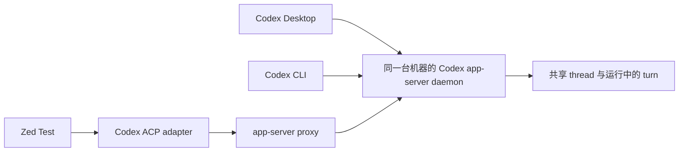

# Zed Test：共享 Codex thread、原生 fork 和紧凑工具卡

这是个人使用的 Zed fork。基于 [Zed PR #63531](https://github.com/zed-industries/zed/pull/63531) 的
`6b990e1423b3e52cc35081e1b958f01a15ceb700`，在它的 thread fork 功能上增加共享
Codex app server、历史分页、工具卡折叠、UI 构建优化和稳定性修复。

## 一台机器共享一个 app server

Zed 的 Codex ACP 适配器通过 `codex app-server proxy` 连接已有 daemon。
Zed 拥有自己的适配器和 proxy 连接，执行状态由 daemon 管理。使用同一 daemon/socket
的 Codex Desktop、CLI 和 Zed 可以同时查看同一个 thread，其他客户端发送的用户消息、
回答和工具事件也会实时进入 Zed。



仅共用 `CODEX_HOME` 不够：三个客户端需要实际连接同一个 server。独立 server 之间
仍可能遇到 active-writer 锁。远程项目连接的是远程机器的 daemon，每台机器分别管理。

适配器在挂接已有 thread 时只传 `threadId` 和 `excludeTurns` 给 `thread/resume`，
不会因为打开历史就覆盖其 cwd、MCP 或运行配置。审批广播由适配器处理；没有对应
本地处理器时，等待其他客户端处理，而不是自动否决它的请求。

## Fork Thread

在 thread 列表右键选择 **Fork Thread**。适配器使用 app server 原生的 `thread/fork`，
得到具有历史的新 thread ID；原 thread 保留。侧栏和原生/外部 agent 的核心 fork
入口来自 PR #63531，这个 fork 另补了已打开远程 ACP thread 的入口。

远程 thread 必须先打开所属远程 workspace，fork 请求才会发送到正确的远程 agent。

## 命令与输出的折叠

多行 `tmux`、`sleep` 或 shell 脚本默认只显示一行命令摘要，输出只预览末尾三行。
点 **Show details** 可以展开完整命令和完整输出，复制命令仍得到原始内容。
等待执行许可的卡片显示完整命令，方便审核。

这是参考 Codex CLI 展示方式改写的 Zed UI；没有把 CLI 的渲染器嵌入 Zed。

## 长 thread 和滚动性能

- 初次打开只回放最近 **100 个原生历史 item**，向上滚动或点击顶部提示再加载更早页面。
- 插入历史时保留滚动位置、编辑器状态和实时消息；分页失败可以重试。
- 现有虚拟列表继续使用；分页只影响显示，不减少模型上下文。
- 新格式存储通过 `thread/items/list` 分页；旧格式仍需在适配器先读取全量历史，再分批回放给 UI。
- GPUI 清理 focus handle 时只处理最后一个引用已释放的 ID，不再每轮扫描全部存活 handle。
- 构建脚本对 `gpui`、`gpui_macos`、`ui`、`markdown`、`editor`、`agent_ui`、
  `workspace`、`ui_input` 使用 `opt-level=2`。

两次 10 秒 CPU 采样显示，主线程采样中约 80%–89% 位于 GPUI 绘制调用树，涉及布局、
prepaint、绘制与内存分配。最后一次提速主要新增了 `workspace` 和 `ui_input` 的优化编译；
历史分页此前已经安装，不能算成最后一次的新增效果。用户重启后报告滚动明显流畅，
目前没有严格同工作负载的前后 FPS 基准，不声称具体提速倍数。

`ZED_TEST_PROFILE_UI=1` 会开启约十分钟的逐窗口 draw-duration/input-latency 日志，
包含均值、p50、p95 和最大值。draw duration 不等于实际屏幕 FPS。

## 关闭 Zed 与手动 Continue

此前适配器的 `closeSession` 对 Zed 发起且尚未完成的 prompt 执行 `turn/interrupt`，
但对其他客户端发起的 turn 只取消订阅。因而关闭编辑器可能打断 Zed 发起的工作；
重新打开 thread 不会重新发送上一条 prompt，需要手动 Continue。

本仓库的适配器补丁统一了这两种来源：关闭会话只取消订阅，ACP 连接断开只结束本地 RPC。
即使 `turn/start` 尚未返回，已经提交给 daemon 的 turn 也不会被关闭逻辑中断。
显式 **Stop / session/cancel** 和连接存活时的 RPC 请求取消仍会中断工作。

daemon 需要持续运行。已完成、失败或被显式停止的 turn 不会因为重新打开 UI 自动开始
下一轮；需要客户端交互的审批/工具也仍需要可用的客户端。
这与 [Codex 官方 app-server 文档](https://developers.openai.com/codex/app-server)
中取消订阅和中断 turn 是两个操作的设计一致。

## 构建与配置

先按上游 [macOS](docs/src/development/macos.md) 或 [Linux](docs/src/development/linux.md)
开发文档安装系统依赖，以及 Rust 1.97.1、Python 3、Node.js 和 npm。

```sh
git clone --branch zed-test https://github.com/bre01/zed.git
cd zed
sh script/zed-test/build.sh
python3 script/zed-test/build-adapter.py --install
```

`build.sh` 使用这次已验证的优化配置，产物为 `target/debug/zed`。数据目录默认是
macOS 的 `~/Library/Application Support/Zed Test`，Linux 的
`${XDG_DATA_HOME:-~/.local/share}/zed-test`。可通过 `ZED_TEST_DATA_DIR` 指定其他目录，
通过 `ZED_TEST_BUILD_JOBS` 控制编译并发。macOS App bundle 打包参照上游构建说明，
自定义应用名使用 Zed Test，bundle ID 使用 `dev.zed.Zed-Test`，URL scheme 使用 `zed-test`。

`build-adapter.py` 从 `integration/codex-acp/base.json` 指定的提交获取源码，应用随仓库
提供的 `shared-server.patch`，执行 typecheck 和 bundle。它默认只构建；`--install`
将适配器和启动脚本装到 `~/.local/share/zed-test/codex-acp`。补丁基于
`agentclientprotocol/codex-acp@4583cb3978276c2b7ea87fcfa5ae66e1e9817f13`，
保留其 Apache-2.0 许可。

在 Zed Test 的设置中添加：

```json
{
  "agent_servers": {
    "codex-acp": {
      "type": "custom",
      "command": "sh",
      "args": ["-c", "exec \"$HOME/.local/share/zed-test/codex-acp/run\""],
      "env": {}
    }
  }
}
```

Codex binary 必须支持 `app-server proxy`，daemon 必须由原有 Codex 管理方式提前启动。
可用 `CODEX_PATH` 指定 binary；`CODEX_APP_SERVER_SOCKET` 指定实际的共享控制 socket，
不设置时使用 Codex 的默认 socket。这个仓库的适配器不会启动或停止 daemon。
远程 workspace 使用相同配置前，应先在远程机器构建/安装适配器。

测试客户端在远程下载匹配的官方 `zed-remote-server`，放在独立的测试文件名下。
这项兼容性已在当前 1.21.0 基线上验证，不保证随意混用不同版本的 client/server。

## 验证记录

以下是本次工作的本地验证记录，不等同于 GitHub CI 已运行：

- 适配器完整测试：**1,220 通过，33 跳过**；TypeScript typecheck 通过。
- 关闭会话覆盖自身 active prompt、其他客户端 turn、晚返回的 `turn/start`、重连及
  transport 断开；保留了显式取消和取消竞态的回归测试。
- 此前实际共享 daemon 验证：两个客户端同时挂接、外部消息实时更新、原生 fork 和历史继承。
- 工具卡：五个测试通过，包括实际 disclosure 点击、展开/折叠、Unicode 和完整审批命令。
- 历史分页：适配器协议、页面重试、历史插入滚动位置、实时消息保留的测试通过。
- Git 历史缓存恢复：62 个测试通过，另一个测试跳过。
- Zed 优化构建通过；日志包装脚本会记录 stdout、stderr、启动/退出时间与退出码。

仅上传源码、适配器补丁和构建/诊断脚本，不包含个人 thread、设置、日志或 Rust 构建缓存。
